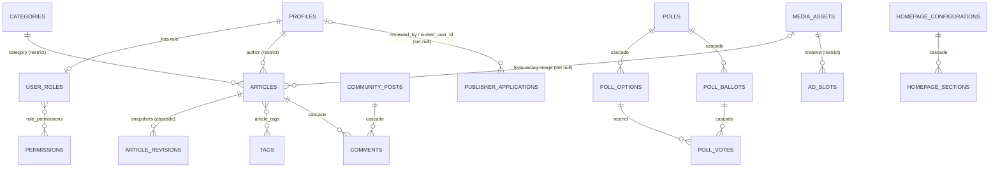

# Database Schema

Source of truth: `supabase/migrations/*.sql` (applied in filename order) and `supabase/seed.sql`.
Everything lives in the `public` schema unless noted. Every table has RLS enabled.

Conventions used below:

- **RLS: S / I / U / D** = select / insert / update / delete.
- `perm(x)` = `public.has_permission('x')`. `staff` = `public.is_staff()` (active profile + a role).
- "definer" = `SECURITY DEFINER` function (runs as the owner, bypasses RLS, does its own checks).
- **Service-only** = `EXECUTE` revoked from `public, anon, authenticated` and granted to `service_role`. These are called from Next.js route handlers with the service key.

## 1. Migrations

| File | Contents |
|---|---|
| `20261106000100_core_rbac.sql` | Extensions (`citext`, `pg_trgm`), `app_role`, profiles, roles, permissions matrix, auth helpers, audit/activity logs, team RPCs, `site_settings`. |
| `20261106000200_content.sql` | Media, categories, tags, locations, articles (+ contributors, tags, related, revisions), editorial state machine, scheduler, pages (+ revisions), trending topics, navigation, homepage builder, redirects. |
| `20261106000300_engagement.sql` | Rate limits, polls (options, ballots, votes), community posts, comments, moderation reports, newsletter, page-view analytics, retention. |
| `20261106000400_storage.sql` | `media` storage bucket and `storage.objects` policies. |
| `20261106000600_media_usage.sql` | `media_usages()` reference finder and the media in-use delete guard. |
| `20261106000800_staff_directory.sql` | `staff_directory()` (staff emails and sign-in times from `auth.users`). |
| `20261106000900_seo_settings_policy.sql` | `settings_write` also lets `seo.manage` holders write the `seo` key. |
| `20261106001000_top_stories_block.sql` | Adds `top_stories` to the allowed `homepage_sections.block_type` values (ADR-012). |
| `20261106001100_english_labels.sql` | Optional English labels: `navigation_items.label_en`, `homepage_sections.title_en`/`description_en`; `publish_homepage` and `restore_homepage_to_draft` copy them (ADR-015). |
| `20261107000100_ad_slots.sql` | `ads.manage` permission (Owner, Administrator), the `ad_slots` table and its RLS, and `media_usages()` extended to ad creatives. |
| `20261107000200_publisher_applications.sql` | `publisher_applications` table and RLS, `submit_publisher_application()`, `review_publisher_application()` and `purge_old_publisher_applications()` (ADR-018). |
| `20261112000100_report_reviewing_status.sql` | Adds `reviewing` to the `report_status` enum. Alone in its file, because a new enum value cannot be used in the transaction that adds it. |
| `20261112000200_resolve_report_reviewing.sql` | `resolve_report()` replaced: `resolved_by` and `resolved_at` are set only for resolved and dismissed, and cleared for open and reviewing. Same signature, permission check, activity log and grants. |
| `20261113000100_mission_statement.sql` | Data only: the client's mission statement (ADR-023). Site Settings tagline and description, SEO default title and description, and the published About page (`tungkol`). |
| `20261113000200_tips.sql` | Tip line (ADR-024): `tips.manage` permission (Owner, Administrator, Editor), the `tips` table and its RLS, `submit_tip()`, `review_tip()` and `purge_old_tips()`. |
| `20261113000250_review_tip_conflict_code.sql` | `review_tip()` raises `tip_changed` with SQLSTATE `22023` instead of `40001`: PostgREST retries `40001` (serialization failure) as transient, so a stale Studio form never got an answer. |
| `20261113000300_tip_line_nav.sql` | Data only: header (`Mag-ulat`) and footer (`Mag-ulat ng Katiwalian`) links to `/mag-ulat` on an existing site. Kept apart from the table so the links went live after the page was deployed. |
| `20261113000400_homepage_mission_band.sql` | Data only: the mission band (ADR-023), a `custom_cta` section inserted right after `top_stories` in the draft and published homepage configuration; later sections move down one position. Idempotent. |

There are no down migrations. To roll back, drop the objects in reverse migration order (the header of `000100` points here for that).

## 2. Enums

| Enum | Values |
|---|---|
| `app_role` | owner, administrator, editor, writer, moderator, analyst |
| `media_kind` | image, video, file |
| `location_kind` | island_group, region, province, city |
| `article_status` | draft, pending_review, approved, rejected, scheduled, published, archived |
| `page_status` | draft, published, archived |
| `homepage_status` | draft, published, archived |
| `poll_status` | draft, published, closed, archived |
| `poll_kind` | single, multiple |
| `poll_results_visibility` | always, after_vote, after_close, hidden |
| `poll_voting_policy` | one_per_browser, one_per_browser_and_network |
| `community_kind` | perspective, question, discussion |
| `moderation_status` | pending, approved, rejected, hidden, removed |
| `report_reason` | spam, harassment, hate_speech, misinformation, violence, privacy, other |
| `report_status` | open, reviewing, resolved, dismissed (`reviewing` added by `20261112000100`) |
| `subscriber_status` | subscribed, unsubscribed, suppressed |

## 3. Tables

### 3.1 Identity and RBAC

| Table | Purpose and key columns | RLS |
|---|---|---|
| `profiles` | One row per auth user. `id` PK → `auth.users` **cascade**. `display_name` (1–120), `slug` unique kebab-case, `title`, `bio` (≤2000), `avatar_url`, `is_active`, `deactivated_at`. Created by the `on_auth_user_created` trigger. | S: staff, self, or anyone for profiles credited on a public article (author or contributor). U: self, or `perm(users.manage)`. `is_active`/`deactivated_at` can change only through `set_user_active()` (see `profiles_guard`). No I/D policies. |
| `user_roles` | One role per user. `user_id` PK → profiles **cascade**; `role app_role`; `assigned_by` → profiles **set null**. Index on `role`. | S: own row or `perm(users.view)`. No write policies: changes go through `set_user_role()`. |
| `permissions` | Permission catalogue. `key` PK matches `^[a-z_]+\.[a-z_]+$`; `group_name`, `description`. 28 keys are seeded in the core migration, `ads.manage` is added by `20261107000100` and `tips.manage` by `20261113000200` (30 in total; see `docs/ADMIN_RBAC.md`). | S: staff. |
| `role_permissions` | Role → permission matrix. PK `(role, permission)`; `permission` → permissions **cascade**. The migration seeds it: owner gets all, administrator gets all except `roles.manage`, plus fixed sets for editor, writer, moderator and analyst. | S: staff. Writes go through `set_role_permission()`. |

### 3.2 Content

| Table | Purpose and key columns | Notable indexes | RLS |
|---|---|---|---|
| `media_assets` | Media library entry. `kind`; `storage_path` unique, matches `<uuid>/<file>`; `external_url` (https only); one of the two is required. `file_name`, `mime_type`, `size_bytes`, `width`/`height`, `title`, `alt_text` (≤300), `caption`, `credit`, `folder` (default `pangkalahatan`), `uploaded_by` → profiles **set null**. | `created_at desc`, `folder`, trigram GIN over title + file_name + alt_text | S: everyone (anon included). I: `perm(media.upload)` and `uploaded_by = auth.uid()`. U/D: `perm(media.manage_any)`, or `perm(media.upload)` on your own uploads. Deletes are also blocked while the asset is in use (trigger). |
| `categories` | `slug` unique, `name` (1–80), `description`, `image_id` → media **set null**, `seo_title`, `seo_description`, `is_featured`, `is_active`, `sort_order`. | `(sort_order, name)` | S: active rows, or staff. All writes: `perm(taxonomy.manage)`. |
| `tags` | `slug` unique, `name`, `description`. | — | S: everyone. All writes: `perm(taxonomy.manage)`. I is also allowed with `perm(articles.create)` (`tags_writer_insert`). |
| `locations` | Region tree. `slug` unique, `name`, `kind`, `parent_id` → locations **restrict**. Check: `island_group` if and only if `parent_id` is null; a row cannot be its own parent. | `parent_id` | S: active rows, or staff. All writes: `perm(taxonomy.manage)`. |
| `articles` | Stories. `slug` unique (≤160), `title` (1–300), `subtitle`, `excerpt`, `body` (TipTap JSON), `body_html`, `body_text`, `status`. FKs: `category_id` → categories **restrict**, `location_id` → locations **set null**, `author_id` → profiles **restrict** (NOT NULL), `featured_image_id`/`og_image_id` → media **set null**, `reviewed_by`/`approved_by`/`published_by`/`created_by` → profiles **set null**. Flags: `is_featured`, `is_breaking`, `is_editors_pick`, `allow_comments`. SEO: `seo_title`, `seo_description`, `canonical_url` (https). Also `source_attribution`, `correction_note`, `reading_minutes` (1–240). Workflow timestamps: `published_at`, `first_published_at`, `content_updated_at`, `submitted_at`, `reviewed_at`, `approved_at`, `archived_at`. Notes: `review_note`, `rejection_reason`. Generated `search_vector` (weighted, `simple` config). | `(status, published_at desc)`, `(category_id, published_at desc)`, `location_id`, `author_id`, `updated_at desc`, GIN `search_vector`, trigram `title` | S: public rows (`article_is_public`), `perm(articles.view_all)`, or staff who are the author or a contributor. I: `perm(articles.create)` and (own `author_id` or `perm(articles.edit_any)`). U: `perm(articles.edit_any)`, or `perm(articles.edit_own)` + author + status draft/rejected. D: `perm(articles.delete)`. |
| `article_contributors` | PK `(article_id, profile_id)`; both FKs **cascade**. `role_label` (default `Kontribyutor`), `position`. | `profile_id` | S: `can_view_article()`. Writes: `can_edit_article()`. |
| `article_tags` | PK `(article_id, tag_id)`; both FKs **cascade**. | `tag_id` | S: `can_view_article()`. Writes: `can_edit_article()`. |
| `related_articles` | PK `(article_id, related_article_id)`; both FKs **cascade**; self-reference is rejected. `position`. | — | S: `can_view_article()`. Writes: `can_edit_article()`. |
| `article_revisions` | Snapshots. `article_id` → articles **cascade**; `revision_number` unique per article; `title`, `snapshot` JSON (content fields + `tag_ids`), `note`, `created_by`. | unique `(article_id, revision_number)` | S: staff and `can_view_article()`. No write policies: rows are written only by `snapshot_article()`. |
| `pages` | Static pages. `slug` unique (≤120), `title`, `summary`, `body`/`body_html`/`body_text`, `status page_status`, SEO fields, `og_image_id` → media **set null**, `robots_noindex`, `published_at`, `created_by`/`updated_by`. | — | S: `status = 'published'`. All operations: `perm(pages.manage)`. |
| `page_revisions` | Same shape as `article_revisions`, keyed by `page_id` (**cascade**). | unique `(page_id, revision_number)` | S: `perm(pages.manage)`. Written only by `snapshot_page()`. |

### 3.3 Homepage

Since ADR-017 there is no Studio homepage builder. These tables are unchanged and the public site reads the published configuration.

| Table | Purpose and key columns | RLS |
|---|---|---|
| `homepage_configurations` | Homepage versions. `status homepage_status`, `label`, `published_at`, `published_by`, `updated_by`. Partial unique indexes allow **one draft** and **one published** row. | S: published, or `perm(homepage.manage)`. I/U: `perm(homepage.manage)`, and only while status is `draft`. No D policy. |
| `homepage_sections` | Blocks. `configuration_id` → configurations **cascade**. `block_type` is one of 18 values (hero, trending_topics, breaking_news, featured_story, latest_articles, article_grid, category_showcase, editors_picks, most_read, poll_showcase, community, regional_news, newsletter, custom_cta, photo_of_day, quote_of_day, news_quiz, and `top_stories` from migration `1000`). `title_en`/`description_en` hold optional English labels. Also `position`, `is_enabled`, `title`, `description`, `settings jsonb` (must be an object; validated in `src/lib/homepage/blocks.ts`). Index `(configuration_id, position)`. | S: sections of the published configuration, or `perm(homepage.manage)`. All writes: `perm(homepage.manage)` and only on the draft configuration. |

### 3.4 Navigation and trending

| Table | Purpose and key columns | RLS |
|---|---|---|
| `navigation_menus` | `key` unique (`^[a-z_]+$`), `name`. Seeded: `header`, `footer_main`, `footer_legal`. | S: everyone. No write policies (menus are fixed by the seed). |
| `navigation_items` | `menu_id` → menus **cascade**, `parent_id` → items **cascade** (dropdowns). `label` (1–60), optional `label_en` (1–60), `href` (`/…` or `https://…`), `position`, `is_visible`, `open_in_new_tab`. Index `(menu_id, parent_id, position)`. | S: visible rows, or staff. All writes: `perm(navigation.manage)`. |
| `trending_topics` | Editorially curated topics. `label`, exactly one of `category_id` (**cascade**), `tag_id` (**cascade**) or `href` (relative path). `position`, `is_active`. | S: active rows, or staff. All writes: `perm(taxonomy.manage)`. |

### 3.5 Engagement

| Table | Purpose and key columns | RLS |
|---|---|---|
| `polls` | `slug` unique (≤140), `question` (5–300), `description`, `kind`, `max_choices` (1–20; must be 1 when `single`), `status`, `is_featured` (partial unique index: at most one featured poll), `opens_at`/`closes_at` (close must be after open), `results_visibility`, `voting_policy`, `methodology_note`, `category_id` → categories **set null**, `published_at`, `closed_at`, `created_by`/`updated_by`. Index `(status, published_at desc)`. | S: status published/closed, or `perm(polls.manage)`/`perm(polls.view_results)`. All writes: `perm(polls.manage)`. |
| `poll_options` | `poll_id` → polls **cascade**, `label` (1–200), `position`. | S: any row whose poll is visible to the caller. All writes: `perm(polls.manage)`. |
| `poll_ballots` | One ballot per voter per poll. `poll_id` **cascade**, `voter_hash` (64-char HMAC), `network_hash` (64-char HMAC or null). Unique `(poll_id, voter_hash)`. Indexes `(poll_id, network_hash)`, `created_at`. | No policies, so no direct access. Written by `cast_vote()`, read through definer functions. |
| `poll_votes` | Chosen options. `ballot_id` → ballots **cascade**, `poll_id` **cascade**, `option_id` → options **restrict**. Unique `(ballot_id, option_id)`. Index `(poll_id, option_id)`. | No policies. |
| `community_posts` | Usap Bayan submissions. `kind`, `title` (5–200), `body` (20–5000), `author_name`, `author_email citext`, `author_location`, `category_id` **set null**, `staff_author_id` **set null**, `status moderation_status` (default `pending`), `is_featured`, `allow_comments`, `network_hash`, `moderated_by`/`moderated_at`/`moderator_note`, `published_at`. Index `(status, published_at desc)`. | S: approved rows, or `perm(moderation.manage)`. I: `perm(moderation.manage)`, own `staff_author_id`, status `pending`. U: `perm(moderation.manage)` on staff-authored rows. The `anon` role only gets column-level SELECT on non-private columns (no email, network hash or moderator fields). |
| `comments` | Exactly one of `article_id` (**cascade**) or `community_post_id` (**cascade**). `parent_id` → comments **cascade**. `author_name`, `author_email`, `body` (2–2000), `status` (default `pending`), `network_hash`, moderation fields. Indexes on article, post and status. | S: approved rows, or `perm(moderation.manage)`. `anon` gets column-level SELECT only (no email, hash or moderator fields). No write policies; writes go through RPCs. |
| `moderation_reports` | Exactly one of `community_post_id` or `comment_id` (both **cascade**). `reason`, `details` (≤1000), `status` (default `open`), `network_hash`, `resolved_by`/`resolved_at`/`resolution_note`. Index `(status, created_at desc)`. | S: `perm(moderation.manage)`. Writes go through RPCs. |

### 3.6 Newsletter

| Table | Purpose and key columns | RLS |
|---|---|---|
| `newsletter_subscribers` | `email citext` unique (≤254), `status`, `consent_given` (check: must be true), `consent_text`, `consent_at`, `source`, `unsubscribe_token uuid` unique, `subscribed_at`, `unsubscribed_at`, `suppressed_at`, `suppression_reason`. Index `(status, subscribed_at desc)`. | S: `perm(newsletter.view)`. D: `perm(newsletter.manage)` (audited). No I/U policies: writes go through RPCs. |

### 3.7 Analytics and rate limits

| Table | Purpose and key columns | RLS |
|---|---|---|
| `page_view_events` | `path` (≤500), `article_id`/`category_id` **set null**, `visitor_hash` (64 chars; a daily-salted HMAC of IP + user agent, computed in the app), `referrer_host`. Raw IPs and user agents are never stored. Indexes: `created_at`; `(article_id, created_at)`; `(visitor_hash, path, created_at desc)`. Rows older than 13 months are purged. | No policies. Written by `record_page_view()`, read through definer functions. |
| `rate_limits` | Fixed-window counters. PK `(key, window_start)`, `hits`. | No policies (service-only). |

### 3.8 Settings, redirects, audit

| Table | Purpose and key columns | RLS |
|---|---|---|
| `site_settings` | `key` PK, one of: general, social, contact, seo, footer, publication, community, newsletter. `value jsonb` (validated in `src/lib/settings/schema.ts`), `updated_by`. Must never hold secrets. Studio → Settings edits every key except `seo` (ADR-017). | S: everyone. All writes: `perm(settings.manage)`, or `perm(seo.manage)` for the `seo` key (migration `0900`). |
| `redirects` | `source_path` unique (`/…`, no whitespace, ≤300), `destination` (`/`, `/…` or `https://…`), `status_code` (301/302/307/308), `is_active`, `hit_count`, `created_by`. Check: source ≠ destination. | S: active rows, or `perm(seo.manage)`. All writes: `perm(seo.manage)`. |
| `audit_logs` | Append-only. `actor_id` **set null**, `action`, `entity_type`, `entity_id text`, `details jsonb`. Indexes `created_at desc`, `(entity_type, entity_id)`. There is no Studio viewer since ADR-017: read it with SQL. The team member page shows that member's last 20 rows. | S: `perm(audit.view)`. Written only by triggers and definer RPCs. |
| `content_activity_logs` | Editorial and moderation history. `actor_id`, `entity_type`, `entity_id uuid`, `action`, `from_status`, `to_status`, `note`. Indexes `(entity_type, entity_id, created_at desc)`, `created_at desc`. | S: staff. Written only by definer RPCs. |

### 3.9 Ads, publisher applications and tips

| Table | Purpose and key columns | Notable indexes | RLS |
|---|---|---|---|
| `ad_slots` | Direct-sold image ads, managed in Studio → Ad inventory (`/admin/ads`). `name` (1–120), `placement` (`home` or `article`), `image_id` → media_assets **restrict** (required), `alt_text` (≤300, optional), `destination_url` (must match `^https://`, ≤2048; a CHECK), `is_active` (default false), optional `starts_at`/`ends_at` window (end must be after start), `sort_order`, `created_by`/`updated_by` → profiles **set null**, timestamps. The public site shows at most one live ad per placement (lowest `sort_order`, then oldest): on the homepage after the top-stories block, and on article pages after the body. It is labelled "Anunsyo"/"Advertisement" and linked with `rel="sponsored noopener noreferrer"`. Impressions and clicks are not tracked. | partial `(placement, sort_order, created_at) where is_active`; `image_id` | S (anon and authenticated): live ads only (active, `starts_at ≤ now() < ends_at`, both bounds optional), or `perm(ads.manage)` for every row. All writes: `perm(ads.manage)`. Anon has no write grants. Every change is audited by `audit_row_change`. |
| `publisher_applications` | Public requests to join the newsroom from `/admin/apply` (ADR-018). `full_name` (2–120), `email citext` (≤254), `requested_role app_role` (writer or moderator only, default writer), `organization` (≤160), `portfolio_url` (https only, ≤500), `message` (≤2000), `consent_at`, `status` (pending, approved, rejected), `review_note` (≤1000; required when rejected), `reviewed_by` → profiles **set null**, `reviewed_at` (set exactly when not pending), `invited_user_id` → profiles **set null**, `network_hash` (only the hash, never the raw IP), timestamps. Creating a row creates no account and grants no access. | partial unique `(email) where status = 'pending'` (one pending application per email); `(status, created_at desc)` | S: `perm(users.manage)` only. No insert, update or delete policy, and those privileges are revoked from `authenticated`; anon has no privileges. Nobody can update rows directly: inserts go only through `submit_publisher_application()` and decisions only through the audited `review_publisher_application()`. |
| `tips` | Private tips from the public tip line `/mag-ulat` (ADR-024); never published. `subject` (5–200), `details` (30–8000), optional `agency` (≤200), `location` (≤120), `contact_name` (≤120) and `contact` (≤200), `evidence_urls text[]` (≤5; each `https://`, checked in `submit_tip`), `status` (`new`, `reviewing`, `verified`, `dismissed`), `staff_note` (≤2000), `reviewed_by`, `reviewed_at`. Checks: `reviewed_at` is null exactly while `new`; `dismissed` needs a note. No IP address or network hash column. | `(status, created_at desc)` | `tips.manage` holders SELECT only. No insert/update/delete policy; anon has no privileges and `authenticated` has INSERT/UPDATE/DELETE revoked. |

## 4. Functions and RPCs

"Default" in the grants column means the migration has no explicit `REVOKE`, so the normal function grants apply and anon/authenticated can call it through PostgREST.

### Authorization helpers

| Function | Definer | Callable by | Purpose |
|---|---|---|---|
| `is_service_context()` | no | default | True for a `service_role` JWT, or a JWT-less `postgres`/`supabase_admin` session (checked via `session_user`). |
| `auth_app_role()` | yes | default | Role of the caller if their profile is active. |
| `has_permission(perm)` | yes | default | Whether the caller (active profile) holds a permission. |
| `is_staff()` | yes | default | `auth_app_role() is not null`. |
| `my_permissions()` | yes | default | Caller's permission keys (used by `getStaffContext`). |
| `article_is_public(status, published_at)` | no | default | The single definition of public: status published or scheduled, and `published_at <= now()`. |
| `can_edit_article(id)` / `can_view_article(id)` | yes | default | Used by RLS on child tables and by the revision restore action. |
| `poll_has_votes(id)` / `poll_is_open(poll)` | yes / no | default | Poll integrity helpers. |
| `community_requires_moderation()` | yes | default | Reads `site_settings.community.moderation_enabled` (default true). |

### Team, audit, settings

| Function | Definer | Grants | Internal checks / purpose |
|---|---|---|---|
| `write_audit(action, type, id, details)` | yes | authenticated, service_role | Inserts into `audit_logs` with `actor_id = auth.uid()`. Makes no permission check of its own. |
| `write_activity(...)` | yes | revoked from public/anon/authenticated; no explicit grant | Inserts into `content_activity_logs`. Not called by any code. |
| `set_user_role(user, role)` | yes | authenticated, service_role | Requires `users.manage`. You cannot change your own role. Only the owner can assign or remove `owner`. At least one active owner must remain. Audited via the `user_roles` trigger. |
| `set_user_active(user, active)` | yes | authenticated, service_role | Requires `users.manage`. You cannot deactivate yourself. Only the owner can touch an owner. At least one active owner must remain. Writes an audit row. |
| `set_role_permission(role, perm, granted)` | yes | authenticated, service_role | Requires `roles.manage`. The owner role is locked, and `roles.manage` cannot be granted. Audited via trigger. |
| `staff_directory()` | yes | authenticated, service_role | Email, invite, confirmation and last-sign-in times from `auth.users` for staff. Returns rows only when the caller has `users.view`. |

### Editorial

| Function | Definer | Grants | Internal checks / purpose |
|---|---|---|---|
| `snapshot_article(id, note)` | yes | authenticated, service_role | Staff and `can_view_article`. Writes the next revision under an advisory lock. |
| `transition_article(id, to, note, publish_at)` | yes | authenticated, service_role | The editorial state machine (allowed transitions per permission; see `docs/EDITORIAL_WORKFLOW.md`). Requires a rejection reason, a category and a body where applicable, and a future time for `scheduled`. Logs to `content_activity_logs` and snapshots on submit/schedule/publish. |
| `publish_due_articles()` | yes | **service-only** | Moves due `scheduled` articles to `published` through `transition_article`. Raises unless in service context. |
| `snapshot_page(id, note)` | yes | authenticated, service_role | Requires `pages.manage`. |
| `publish_homepage(label)` | yes | authenticated, service_role | Requires `homepage.manage`. Archives the current published version, copies the draft into a new published row, and writes an audit row. |
| `restore_homepage_to_draft(config_id)` | yes | authenticated, service_role | Requires `homepage.manage`. Replaces the draft's sections with a copy of the given configuration's sections. |
| `media_usages(media_id)` | yes | authenticated, service_role | Every reference to an asset (article images or body, category image, page OG image or body, site settings, draft/published homepage sections, and ad creatives as `usage_kind = 'ad_slot'` since `20261107000100`). Labels are hidden where the caller cannot see the row. Returns rows only for staff or service. Because of the ad rows, an image used by an ad cannot be deleted. |

### Engagement and analytics

| Function | Definer | Grants | Internal checks / purpose |
|---|---|---|---|
| `check_rate_limit(key, max, window_s)` | yes | **service-only** | Increments the fixed-window counter and returns `hits <= max`. Prunes rows older than one day on about 1% of calls. |
| `cast_vote(poll, option_ids, voter_hash, network_hash)` | yes | **service-only** | Validates the poll is open and the option count and ownership. One ballot per `voter_hash`; with `one_per_browser_and_network`, also one per `network_hash`. Returns `{status: ok \| already_voted \| closed \| invalid}`. |
| `get_poll_results(poll, voter_hash)` | yes | authenticated, service_role | Applies `results_visibility`; holders of `polls.view_results` always see results. Returns `{visible, has_voted, is_open, total_ballots?, options?[{option_id, votes}]}`. |
| `get_total_ballots()` | yes | anon, authenticated, service_role | Count of all ballots (hero trust copy). |
| `export_poll_votes(poll)` | yes | authenticated | Requires `polls.view_results`. Returns rows `(ballot_id, voted_at, option_label)`. |
| `submit_community_post(...)` | yes | **service-only** | Rejects `discussion`. Status is `pending`, or `approved` when moderation is off. |
| `submit_comment(...)` | yes | **service-only** | Target must be a public article with comments allowed, or an approved post with comments allowed. A parent comment must be approved and on the same target. Raises `comments_closed`, `parent_not_found` or `target_required`. |
| `submit_report(post, comment, reason, details, hash)` | yes | **service-only** | Target must be approved, otherwise raises `target_not_found`. |
| `moderate_content(type, id, action, note)` | yes | authenticated | Requires `moderation.manage`. Actions: approve, reject, hide, remove, feature, unfeature, restore_pending. Only approved posts can be featured. Logs to activity. |
| `resolve_report(id, status, note)` | yes | authenticated | Requires `moderation.manage`. Logs to activity. Sets `resolved_by` and `resolved_at` only for resolved and dismissed, and clears them for open and reviewing (`20261112000200`). |
| `subscribe_newsletter(email, consent_text, source)` | yes | **service-only** | Returns `subscribed`, `already_subscribed`, `resubscribed` or `suppressed`. Suppressed addresses are never resubscribed. |
| `unsubscribe_newsletter(token)` | yes | **service-only** | Sets `unsubscribed`. Returns whether the token exists. |
| `set_subscriber_status(id, status, reason)` | yes | authenticated | Requires `newsletter.manage`. Writes an audit row. |
| `record_page_view(path, article, visitor_hash, referrer)` | yes | **service-only** | Counts the same visitor and path once per 30 minutes. Drops `article_id` if the article is not public. |
| `get_most_read_article_ids(days, limit, category)` | yes | anon, authenticated, service_role | Public articles only. Days clamped to 1–365, limit to 1–50. |
| `get_article_view_counts(ids[])` | yes | authenticated | Returns rows only for staff. |
| `analytics_summary(from, to)` | yes | authenticated | Requires `analytics.view`. Range must be at most 400 days. Day buckets use Asia/Manila. Returns totals, per-day series and top-10 lists. |
| `purge_old_analytics()` | yes | **service-only** | Deletes page views older than 13 months and rate-limit rows older than one day. Returns the number of page views deleted. |

### Publisher applications

| Function | Definer | Grants | Internal checks / purpose |
|---|---|---|---|
| `submit_publisher_application(full_name, email, requested_role, organization, portfolio_url, message, network_hash)` | yes | **service-only** | Called by the `submitApplication` server action after Zod validation, the honeypot and the `application` rate limit (3 per hour per network). Trims the input and stores a pending row. A second pending application for the same email is silently ignored (`on conflict do nothing`), so the reply never reveals who has applied or who is staff. |
| `review_publisher_application(id, decision, note, role, invited_user_id)` | yes | authenticated, service_role | Requires `users.manage`. Allows only pending → approved or rejected (`application_already_reviewed` otherwise). A rejection needs a reason (`rejection_reason_required`). An approval may record only Writer or Moderator as the granted role, or null when the applicant was already staff. Writes an `approve_application` or `reject_application` audit row with no name, email or message. The invitation itself is sent by the server action before this call. |
| `purge_old_publisher_applications()` | yes | **service-only** | Deletes reviewed applications 180 days after the decision; pending ones stay. Called by the daily `/api/cron/retention` job. Returns the number deleted. |

### Tips

| Function | Definer | Grants | Internal checks / purpose |
|---|---|---|---|
| `submit_tip(subject, details, agency, location, evidence_urls, contact_name, contact)` | yes | **service-only** | Called by `POST /api/public/v1/tips` after Zod validation, honeypot and rate limit. Rejects any evidence link that is not `https://` or is longer than 500 characters (`invalid_evidence_url`); trims text and stores empty optional fields as null. |
| `review_tip(id, status, note, expected_updated_at)` | yes | authenticated, service_role | Requires `tips.manage`. Target status must be `reviewing`, `verified` or `dismissed`; a note is required to dismiss. Locks the row and refuses the change with `tip_changed` when its `updated_at` is not the one the caller's form was built from. Replaces the note, records `reviewed_by`/`reviewed_at`, and writes an audit row (`review_tip`) holding only the old and new status. |
| `purge_old_tips()` | yes | **service-only** | Deletes tips dismissed more than 180 days ago. Called by the daily `/api/cron/retention` job. |

## 5. Triggers

| Trigger | Table / timing | Behaviour |
|---|---|---|
| `on_auth_user_created` | `auth.users` AFTER INSERT | `handle_new_user()` creates a profile. Display name comes from metadata, then the email local part, then `Staff`. |
| `profiles_guard` | `profiles` BEFORE UPDATE | Raises `use_set_user_active` if the `anon`/`authenticated` role changes `is_active` or `deactivated_at`. |
| `articles_guard` | `articles` BEFORE INSERT/UPDATE | On API inserts: forces `draft`, clears all workflow fields, sets `created_by`, and clears placement flags without `articles.publish`. On API updates: raises `workflow_fields_protected` if status or workflow columns change, `placement_requires_publish_permission` if flags change without `articles.publish`, and `author_change_not_allowed` if the author changes without `articles.edit_any`. Sets `updated_at`, and sets `content_updated_at` when the title, body, subtitle or correction note of a live article changes. Definer RPCs (owner role) skip these checks. |
| `polls_guard` | `polls` BEFORE UPDATE | After votes exist, `question`, `kind`, `max_choices` and `voting_policy` are frozen (`poll_locked_after_votes`). Stamps `published_at` and `closed_at`, and sets `updated_at`. |
| `poll_options_guard` | `poll_options` BEFORE I/U/D | After votes exist, only reordering is allowed (`poll_options_locked_after_votes`). |
| `media_assets_block_in_use` | `media_assets` BEFORE DELETE | Raises `media_in_use` (23503) if `media_usages()` returns any row. |
| `*_touch` (`touch_updated_at`) | profiles, site_settings, media_assets, categories, tags, pages, navigation_items, homepage_configurations, homepage_sections, redirects, community_posts, newsletter_subscribers, ad_slots, publisher_applications | Sets `updated_at = now()`. |
| Audit (`audit_row_change`) | user_roles (I/U/D), role_permissions (I/D), site_settings (I/U/D), articles (D), pages (D), redirects (I/U/D), polls (I/U/D), poll_options (I/U/D), newsletter_subscribers (D), ad_slots (I/U/D) | Writes old/new JSON to `audit_logs`, without body, HTML, text or search vector. |

## 6. Storage

Bucket `media`:

- Public, so reads go through the public URL.
- 10 MiB file limit (10485760 bytes).
- MIME types: jpeg, png, webp, gif, avif, pdf.
- Object paths are `<uploader uuid>/<file>`.

| Policy on `storage.objects` | Rule |
|---|---|
| `media_objects_staff_read` (S) | Authenticated staff. |
| `media_objects_insert` (I) | `perm(media.upload)`, and the first folder equals `auth.uid()`. |
| `media_objects_update` (U) | `perm(media.manage_any)`, or `perm(media.upload)` inside your own folder. |
| `media_objects_delete` (D) | Same rule as update. |

## 7. Core relationships

## 8. Seed (`supabase/seed.sql`)

The seed is structural only. Pages, navigation, the homepage configuration and SEO settings are no longer editable in Studio (ADR-017); the rest is. It is idempotent: it uses `on conflict do nothing` or `where not exists`.

| Seeded | What |
|---|---|
| Categories | 17 starter categories (pilipinas … lipunan) with `sort_order`; 8 are featured. |
| Locations | 3 island groups and 18 regions. No provinces or cities. |
| Navigation | Menus `header`, `footer_main`, `footer_legal` with their items (inserted only if the menu is empty). |
| Site settings | All 8 keys: site name and tagline, brand colours, Asia/Manila, `fil`, SEO templates, `allow_indexing: true`, community moderation on, newsletter consent text. Social and contact values are empty strings. |
| Trending topics | 8 topics linked to categories. |
| Pages | 6 starter pages (tungkol, makipag-ugnayan, patakarang-editoryal, privacy-policy, terms-of-service, mag-advertise), all **drafts**. |
| Homepage | One draft and one published configuration with the same 10 sections: trending_topics, breaking_news, top_stories, custom_cta (the mission band, ADR-023), latest_articles, editors_picks, newsletter, category_showcase, regional_news, poll_showcase. Image and poll ids are null. |

The seed contains **no users, articles, polls, votes, comments, subscribers or metrics**. Demo content lives in `scripts/seed-demo.ts`.
